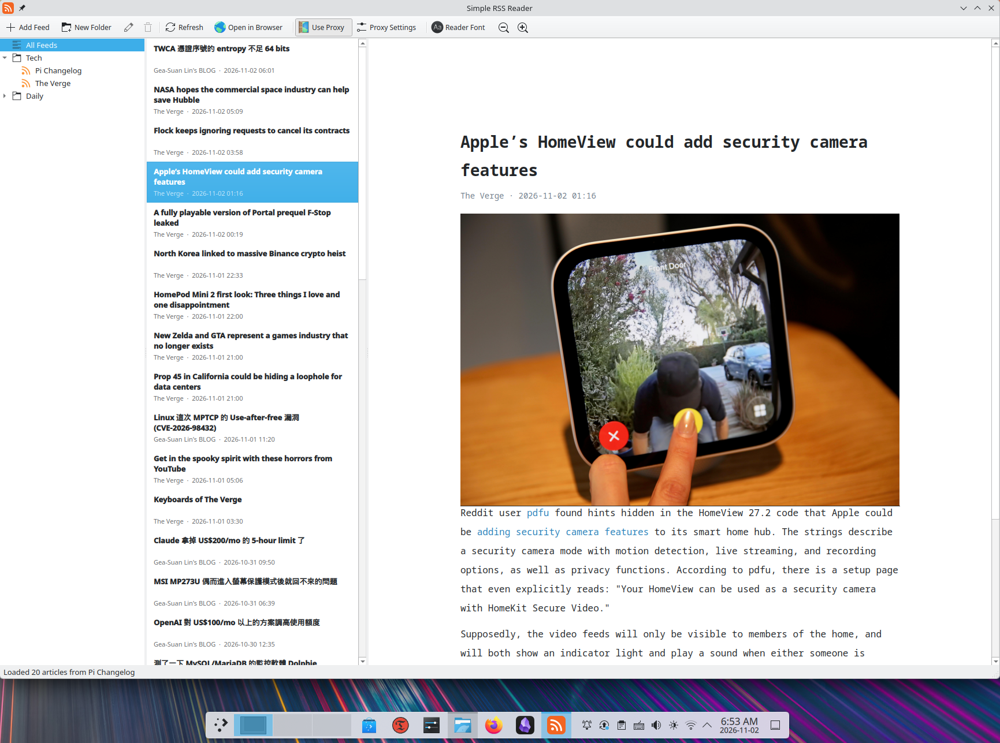
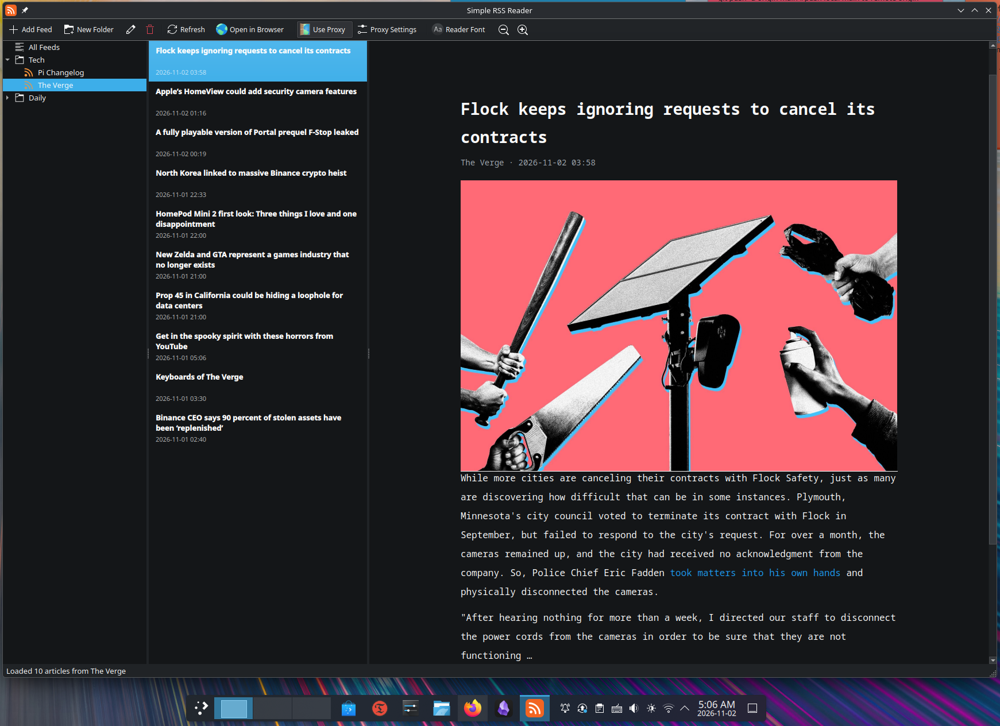

# Simple RSS Reader





A small RSS/Atom feed reader for Linux, built with Python and Qt 6 (PySide6). Made for Fedora KDE Plasma, but it should run on any desktop with Qt 6.

## Features

- Subscribe to RSS and Atom feeds
- Organize feeds into folders (add, rename, delete, drag and drop)
- Read articles with images inside the app
- Manual HTTP or SOCKS5 proxy with an on/off toggle
- Adjustable reader font and text size
- Follows your Plasma theme, including dark mode

## Requirements

- Python 3.10 or newer
- PySide6
- feedparser

## Install

On Fedora:

```bash
sudo dnf install python3-pyside6 python3-feedparser
```

Or use a virtual environment:

```bash
python3 -m venv venv
source venv/bin/activate
pip install PySide6 feedparser
```

## Run

```bash
python3 simple_rss.py
```

## Add to the application launcher

Run this in the same terminal (and venv, if you use one) where the app runs:

```bash
bash install.sh
```

"Simple RSS Reader" will then appear in your application menu. Run the command again after updating `simple_rss.py`.

To remove it:

```bash
bash install.sh --uninstall
```

## Usage

| Action                         | How                                                   |
| ------------------------------ | ----------------------------------------------------- |
| Add a feed                     | **Add Feed** button or `Ctrl+N`                       |
| New folder                     | **New Folder** button or `Ctrl+Shift+N`               |
| Edit a feed or rename a folder | Pencil button or `F2`                                 |
| Delete a feed or folder        | Trash button or `Del`                                 |
| Move a feed to a folder        | Drag it onto the folder, or right-click → **Move to** |
| Refresh all feeds              | **Refresh** button or `F5`                            |
| Bigger / smaller text          | `Ctrl++` / `Ctrl+-` (`Ctrl+0` resets)                 |

Click a folder (or **All Feeds**) to see the articles from all its feeds together, newest first. Right-click anything in the sidebar for more options.

### Proxy

Open **Proxy Settings…**, choose HTTP or SOCKS5, and enter the host and port (username and password are optional). Then switch **Use Proxy** on or off at any time. The proxy applies to feeds and article images, and only to this app.

## Where your data is stored

Feeds, folders, and settings are saved in `~/.config/simple-rss/`. The proxy password is stored there as plain text.

## Limitations

- Articles are not cached, so feeds are fetched again each time the app starts.
- There is no read/unread tracking.
- The article view is basic: heavily styled pages, embedded videos, and iframes will not display fully. Use **Open in Browser** for those.
